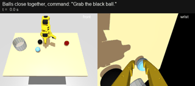

# SO101 Ball Sort: 말로 명령하면 색을 구분해 공을 치우는 로봇 팔

> "Grab the blue ball." → SO101 팔이 하늘색 공을 집어 통에 넣고 제자리로 돌아온다.
> MuJoCo 시뮬레이션에서 SmolVLA(VLA 모델)를 학습시키고, 역강화학습과 손목 카메라 색 확인으로 **색 구분 100%**(600회 중 틀린 공 0회)를 달성했다.

<p align="center">
  <br>
  <sub>한 장면에서 세 명령을 연달아 수행한다. 두 번째와 세 번째는 학습 때 한 번도 쓰지 않은 표현이다. 왼쪽은 정면 카메라, 오른쪽은 손목 카메라. (GIF는 2배속)</sub>
</p>

## 핵심 결과 (시뮬레이션)

| 지표 | 결과 |
|---|---|
| **색 구분** (틀린 색 공을 집은 횟수) | **0 / 600회** |
| 작업 성공 (집기 → 통에 넣기 → 제자리 복귀, 30초 안) | **86.3%** (518 / 600) |
| 처음 듣는 명령 표현 | 성공 83~85%, 틀린 공 0회 |
| 반복 실행 루프 (연속 명령) | 30 / 30 |

<p align="center"></p>

## 시연 영상

### 같은 장면, 다른 명령
배치는 그대로 두고 명령만 바꾼다. 명령을 이해해야만 세 번 모두 맞힐 수 있다.

<p align="center"></p>

### 색 가드: 확인되지 않으면 잡지 않는다
공이 7.7cm 간격으로 붙어 있어 정책이 자주 헷갈리는 장면이다. 손목 카메라가 닫기 직전에 색을 확인한다. 명령한 색을 확인하지 못했거나 틀린 색이면 닫지 않고, 물러났다가 다시 시도한다.

이 시행은 두 번 거부한 뒤 30초 안에 공을 넣지 못하고 끝났다. 틀린 공은 한 번도 잡지 않았다. 색을 지키는 대신 시간을 쓰는 것이 가드의 대가이고, 재시도를 빠르게 하는 것이 남은 과제다. (처음 20초)

<p align="center"></p>

원본 mp4(실제 속도)는 [`portfolio/media/`](portfolio/media/)에 있다. 위의 두 영상은 성공한 시행을 고른 예시이고, 성능 수치는 아래 벤치마크 결과다.

## 어떻게 만들었나

```
명령문 + 정면/손목 영상 + 관절값
        │
        ▼
 SmolVLA (sft_aux2)   ← 시연 1,500개로 모방학습 + "명령한 공 위치 맞히기" 보조 과제
        │  출발 노이즈
 노이즈 조종 정책     ← 역강화학습(IRL): 시범에서 보상을 추론해 학습
        │  행동 묶음 (50스텝 = 1.7초)
        ▼
 색 가드              ← 닫기 직전 손목 카메라로 색 확인. 명령한 색일 때만 잡는다
        │
        ▼
 SO101 팔 (시뮬레이션 / 실제 로봇)
```

| 단계 | 한 일 | 결과 |
|---|---|---|
| 1. 시뮬레이터 | 실제 작업대를 MuJoCo로 재현했다. 카메라, 통, 관절을 실제 녹화에 맞춰 보정했다. | 시연 스크립트 성공 150 / 150 |
| 2. 모방학습 | SmolVLA를 시연으로 학습했다. | 성공 58.7%, 그러나 **틀린 공 23%** |
| 3. 색 구분 돌파 | 팔이 움직이기 전 영상만 보고 "명령한 공의 위치"를 맞히는 보조 과제를 넣었다. 관절값은 지워서 지름길을 막았다. | 틀린 공 23% → **3.3%** |
| 4. 역강화학습 | 판별기가 시범과 정책을 구분하며 보상을 추론한다. 명령만 다른 색으로 바꾼 "바꿔치기 음성 표본"을 넣어 색을 보게 했다. | 성공 92% (기본 명령) |
| 5. 오류 분석 | 틀린 공은 공 간격 12cm 이상에서 0 / 630회, 7~8cm에서 11%였다. 대부분 우연이었다. | 학습만으로 0%는 어렵다고 판단 |
| 6. 색 가드 | 손목 카메라 HSV 판별로 확인한다. 확인된 경우에만 잡고, 놓치면 다시 확인한다. | **틀린 공 0 / 600** |

시도했지만 효과가 없었던 방법도 기록했다: DSRL(강화학습) 3회, LoRA 미세조정, 지름길 제거 데이터.

## 기술 스택

- **로봇 / 시뮬레이션:** SO-101 (LeRobot), MuJoCo 3, Gymnasium
- **모델:** SmolVLA (SmolVLM2-500M + 흐름 정합 행동 전문가), PyTorch
- **학습:** 모방학습(SFT) + 보조 과제, 역강화학습(GAIL 계열 판별기 + KL 정규화 actor-critic)
- **데이터:** LeRobot v3 형식, 시연 스크립트(역기구학 + DART 노이즈 + 보정 시연)로 자동 생성
- **환경:** RTX 5070 Laptop (8GB)

## 벤치마크

| 시험 | 방법 |
|---|---|
| 반사실 시험 | 같은 배치 × 세 색 명령. 첫 잡기 시도가 맞는 공인지 본다(300회). |
| 전체 작업 | 단일 명령 150회 × 4세트, 연속 명령 20회. 성공, 틀린 공, 잡기 실패를 센다. |
| 처음 듣는 명령 | 학습에 쓰지 않은 표현 3종(`get the ...`, `bring the ... one to the box` 등) |
| 실패 원인 분석 | 닫는 순간 집게와 공의 상대 위치로 실패를 11가지로 나눈다. |
| 색 가드 스트레스 | 공이 붙은 배치에서 일부러 빗나가게 닫기 600회. 실제로 들린 공과 비교한다. |

## 문서

- **[프로젝트 보고서](docs/report/2026-10-29-project-report.md):** 전체 과정, 모델, 학습 방식, 데이터셋 제작, 벤치마크, 실제 로봇 이전 계획
- [색 가드 v2 결과](docs/results/guard2/analysis.md) · [잡기 실패 분석](docs/results/grasp/analysis.md) · [틀린 공 원인 분석](docs/results/erran/analysis.md) · [색 구분 시도 기록](docs/results/color_grounding_attempts.md)
- [계획 문서 (Plan 1~9)](docs/superpowers/plans/)

## 폴더 구조

```
sim/        MuJoCo 환경, 명령문 생성
expert/     시연 스크립트 (역기구학)
data/       시연 수집 (LeRobot 데이터셋)
train/      SFT(보조 과제), DSRL, IRL 학습
rl/         보상, 판별기, KL actor-critic
policies/   SmolVLA 어댑터, 노이즈 조종, 색 가드
eval/       전체 작업 평가
tools/      반사실 시험, 실패 분석, 가드 보정 등
run/        반복 실행 루프 (시뮬레이션 / 실제 로봇)
tests/      pytest
```

## 실행

```bash
# 시뮬레이션에서 반복 실행 루프 (명령을 키보드로 입력)
python -m run.loop --backend sim

# 전체 작업 평가
python -m eval.evaluate --policy dsrl --checkpoint outputs/train/sft_aux2_irl/pretrained_model \
  --actor outputs/irl/irl2/last.pt --guard --n-per-color 50 --commands basic

# 실제 로봇 (색 가드 보정 후)
python tools/guard_calibrate.py capture --wrist-cam 1
python -m run.loop --backend real --port COM5 --wrist-cam 1 --front-cam 0
```

모델 가중치와 데이터셋은 용량 때문에 저장소에 넣지 않았다.

## 한계와 다음 단계

- 모든 수치는 **시뮬레이션** 결과다. 실제 로봇에서는 손목 카메라 색 보정과 그리퍼 값 확인이 먼저 필요하다.
- 600회 중 0회는 "오류율 0.5% 미만"이라는 근거이지, 0%의 증명은 아니다.
- 남은 실패는 대부분 잡기 실패(600회 중 82회)다. 약 절반은 집게 끝이 좁아서 생긴다(8~10mm, 공 지름 4cm). 집게 끝을 넓히는 하드웨어 보완으로 줄일 수 있다.

## 출처

- SO-101 로봇 모델과 메시(`sim/so101.xml`, `sim/assets/*.stl`): [MuJoCo Menagerie](https://github.com/google-deepmind/mujoco_menagerie) `robotstudio_so101` (Apache License 2.0, `sim/assets/LICENSE_robotstudio_so101`)
- 정책 모델: [LeRobot](https://github.com/huggingface/lerobot) SmolVLA (`lerobot/smolvla_base`)
