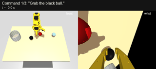
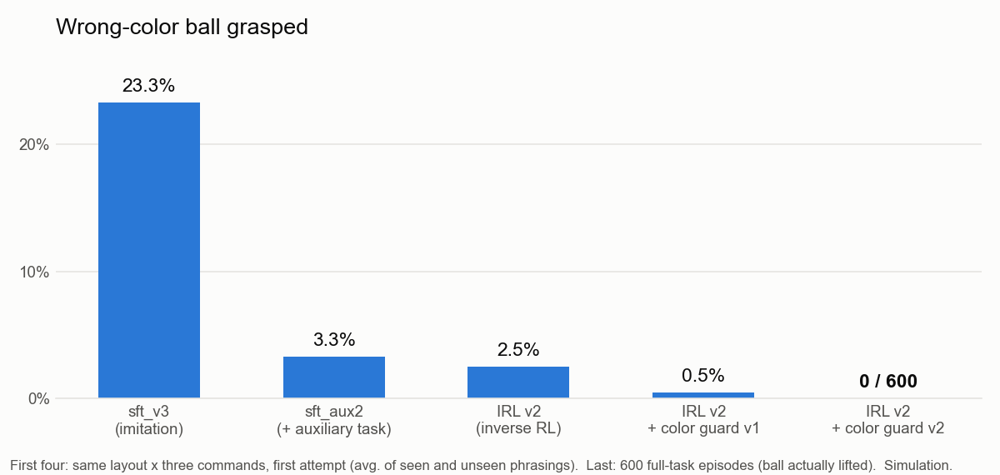
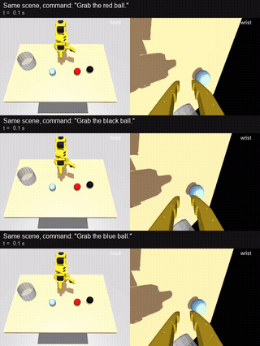

# SO101 Ball Sort: a robot arm that sorts balls by color from spoken commands

> "Grab the blue ball." → the SO101 arm picks the sky-blue ball, drops it in the bin, and returns home.
> SmolVLA (a vision-language-action model) is trained in MuJoCo simulation. Inverse RL plus a wrist-camera color check reach **100% color accuracy** (0 wrong balls in 600 episodes).

<p align="center">
  <br>
  <sub>Three commands in a row in one scene. The second and third phrasings were never used in training. Left: front camera, right: wrist camera. (GIF at 2x speed)</sub>
</p>

## Key results (simulation)

| Metric | Result |
|---|---|
| **Color accuracy** (wrong-color ball grasped) | **0 / 600** |
| Task success (grasp → bin → home, within 30 s) | **86.3%** (518 / 600) |
| Unseen command phrasings | 83–85% success, 0 wrong balls |
| Command loop (consecutive commands) | 30 / 30 |

<p align="center"></p>

## Demo

### Same scene, different commands
The layout stays the same; only the command changes. The arm can get all three right only by understanding the command.

<p align="center"></p>

Original mp4 files (real speed) are in [`portfolio/media/`](portfolio/media/). Both clips are picked successful runs; the performance numbers come from the benchmarks below.

## How it works

```
command text + front/wrist images + joint state
        │
        ▼
 SmolVLA (sft_aux2)      ← imitation learning on 1,500 demos + auxiliary task "locate the commanded ball"
        │  initial noise
 noise-steering policy   ← inverse RL (IRL): reward inferred from demonstrations
        │  action chunk (50 steps = 1.7 s)
        ▼
 color guard             ← checks color with the wrist camera right before closing; grasps only the commanded color
        │
        ▼
 SO101 arm (simulation / real robot)
```

| Stage | What was done | Result |
|---|---|---|
| 1. Simulator | Rebuilt the real workspace in MuJoCo. Calibrated cameras, bin and joints against real recordings. | Scripted expert 150 / 150 |
| 2. Imitation learning | Trained SmolVLA on demonstrations. | 58.7% success, but **23% wrong balls** |
| 3. Color grounding | Added an auxiliary task: predict the commanded ball's position from images before the arm moves. Joint state is masked to block the shortcut. | Wrong balls 23% → **3.3%** |
| 4. Inverse RL | A discriminator separates demos from policy rollouts to infer the reward. "Swapped-command negatives" (same scene, different color command) force it to look at color. | 92% success (basic commands) |
| 5. Error analysis | Wrong balls: 0 / 630 when balls are ≥ 12 cm apart, 11% at 7–8 cm. Mostly chance. | Concluded 0% is hard by training alone |
| 6. Color guard | HSV check on the wrist camera. Grasps only after confirming the color; re-checks after a missed grasp. | **0 / 600 wrong balls** |

Methods that were tried without effect are documented too: DSRL (RL) three times, LoRA fine-tuning, shortcut-removal data.

## Tech stack

- **Robot / simulation:** SO-101 (LeRobot), MuJoCo 3, Gymnasium
- **Model:** SmolVLA (SmolVLM2-500M + flow-matching action expert), PyTorch
- **Training:** imitation learning (SFT) + auxiliary task, inverse RL (GAIL-style discriminator + KL-regularized actor-critic)
- **Data:** LeRobot v3 format, generated automatically by a scripted expert (inverse kinematics + DART noise + recovery demos)
- **Hardware:** RTX 5070 Laptop (8 GB)

## Benchmarks

| Test | Method |
|---|---|
| Counterfactual | Same layout × three color commands. Checks whether the first grasp attempt targets the right ball (300 runs). |
| Full task | 150 single-command episodes × 4 sets, plus 20 consecutive-command runs. Counts success, wrong balls, grasp failures. |
| Unseen phrasings | Three phrasings not used in training (`get the ...`, `bring the ... one to the box`, etc.) |
| Failure analysis | Classifies failures into 11 types by gripper–ball position at the moment of closing. |
| Color guard stress | 600 deliberately off-target closes on layouts with nearby balls, compared against the ball actually lifted. |

## Documents (Korean)

- **[Project report](docs/report/2026-10-29-project-report.md):** full process, models, training, dataset generation, benchmarks, real-robot transfer plan
- [Color guard v2 results](docs/results/guard2/analysis.md) · [Grasp failure analysis](docs/results/grasp/analysis.md) · [Wrong-ball root cause](docs/results/erran/analysis.md) · [Color grounding attempts](docs/results/color_grounding_attempts.md)
- [Plans (Plan 1–9)](docs/superpowers/plans/)

## Repository layout

```
sim/        MuJoCo environment, command generation
expert/     scripted expert (inverse kinematics)
data/       demo collection (LeRobot dataset)
train/      SFT (auxiliary task), DSRL, IRL training
rl/         rewards, discriminator, KL actor-critic
policies/   SmolVLA adapter, noise steering, color guard
eval/       full-task evaluation
tools/      counterfactual test, failure analysis, guard calibration, etc.
run/        command loop (simulation / real robot)
tests/      pytest
```

## Usage

```bash
# Command loop in simulation (type commands on the keyboard)
python -m run.loop --backend sim

# Full-task evaluation
python -m eval.evaluate --policy dsrl --checkpoint outputs/train/sft_aux2_irl/pretrained_model \
  --actor outputs/irl/irl2/last.pt --guard --n-per-color 50 --commands basic

# Real robot (after color guard calibration)
python tools/guard_calibrate.py capture --wrist-cam 1
python -m run.loop --backend real --port COM5 --wrist-cam 1 --front-cam 0
```

Model weights and datasets are not included in the repository because of their size.

## Limitations and next steps

- All numbers are from **simulation**. On the real robot, the wrist-camera color calibration and gripper values must be checked first.
- 0 out of 600 supports "error rate below ~0.5%"; it does not prove 0%.
- Most remaining failures are grasp failures (82 of 600). About half come from the narrow gripper tips (8–10 mm vs. a 4 cm ball); wider tips would reduce them.
- When the guard rejects a grasp, the retry rarely finishes within 30 s. Faster retries are the next step.

## Credits

- SO-101 robot model and meshes (`sim/so101.xml`, `sim/assets/*.stl`): [MuJoCo Menagerie](https://github.com/google-deepmind/mujoco_menagerie) `robotstudio_so101` (Apache License 2.0, `sim/assets/LICENSE_robotstudio_so101`)
- Policy model: [LeRobot](https://github.com/huggingface/lerobot) SmolVLA (`lerobot/smolvla_base`)
